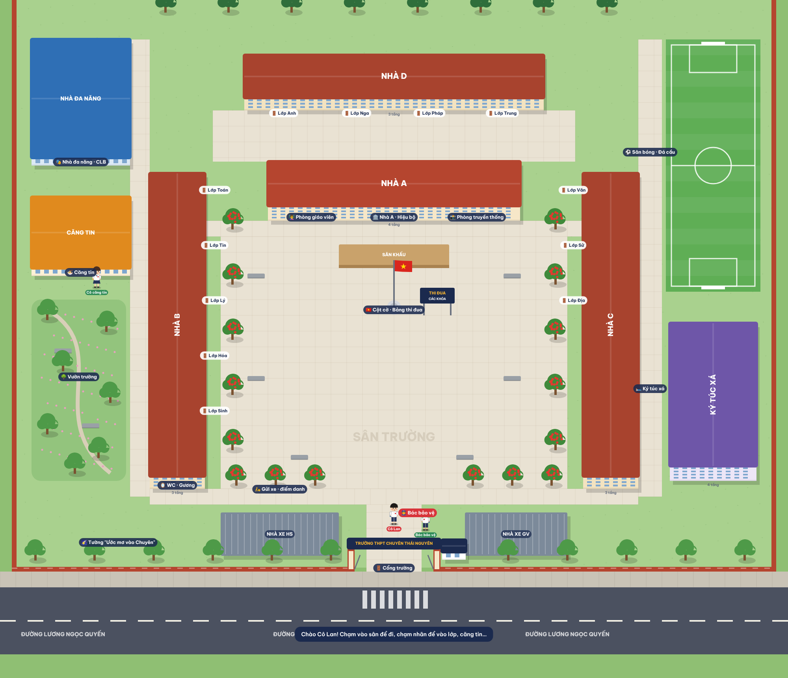

# Trường THPT Chuyên Thái Nguyên – Họp lớp online

Sân trường ảo dựng theo **cơ sở 234A đường Lương Ngọc Quyến, phường Quang Trung, TP Thái Nguyên**
(nơi trường học từ năm 1995 đến 2019). Người dùng tạo nhân vật mặc đồng phục, dạo quanh sân trường,
ghé lớp cũ, viết lưu bút, đăng ký họp lớp và thi đua giữa các khóa.



## Có gì trong sân trường

| Địa điểm | Chức năng |
|---|---|
| Cổng trường, bác bảo vệ | Giới thiệu, trò chuyện với bác bảo vệ |
| Nhà xe học sinh | Điểm danh mỗi ngày, nhận 20k ăn vặt |
| Sân trường: cột cờ, sân khấu, hàng phượng | Bảng thi đua theo khóa, theo lớp chuyên, đá cầu |
| **Nhà A (hiệu bộ)** | Lịch họp lớp (tạo, đăng ký), tri ân thầy cô, phòng giáo viên, phòng truyền thống |
| **Nhà B** | Lớp chuyên Toán, Tin, Lý, Hóa, Sinh; WC cuối dãy có gương để đổi kiểu tóc |
| **Nhà C** | Lớp chuyên Văn, Sử, Địa |
| **Nhà D** | Lớp chuyên Anh, Nga, Pháp, Trung |
| Trong mỗi lớp | Lưu bút theo từng khóa, sổ đầu bài (ai đã về lớp), đố vui theo môn |
| Nhà đa năng | Gian các CLB |
| Căng tin | Thực đơn có giá, mua và đãi bạn; giờ ra chơi thật (9:15–9:35) giảm 20% |
| Sân bóng | Trò đá cầu có bảng xếp hạng |
| Ký túc xá, vườn trường, tường "Ước mơ vào Chuyên" | Góc lưu bút kỷ niệm |

Điều khiển: chạm/nhấp vào sân để đi (tự tìm đường quanh các dãy nhà), chạm nhãn để mở,
trên máy tính dùng thêm phím mũi tên / WASD, cuộn chuột để phóng to/thu nhỏ.
Không cần mật khẩu: mỗi nhân vật có **mã khôi phục** `CTN-XXXX-XXXX` để dùng lại trên máy khác.

## Sửa sơ đồ cho đúng thực tế

Toàn bộ sơ đồ nằm trong [`public/js/campus.js`](public/js/campus.js): toạ độ, kích thước các dãy nhà
(`BUILDINGS`), cửa lớp và lớp chuyên của từng dãy (`CLASS_DOORS`), điểm tương tác (`HOTSPOTS`), cây cối,
ghế đá. Hướng Bắc ở trên, đường Lương Ngọc Quyến ở dưới. Vị trí hiện tại là **ước lượng** theo mô tả
"nhà A là nhà hiệu bộ, nhà B, C, D là các dãy lớp học"; sửa các con số là va chạm, tìm đường,
bản đồ thu nhỏ tự cập nhật theo.

## Cấu trúc

```
public/            giao diện tĩnh (không cần build)
  index.html, style.css, pages/gioi-thieu.html
  js/campus.js     dữ liệu sơ đồ trường
  js/world.js      vẽ canvas 2D, camera, tìm đường A*, người chơi khác
  js/avatar.js     vẽ nhân vật đồng phục
  js/main.js       luồng tạo nhân vật và các bảng chức năng
  js/games.js      đá cầu, câu hỏi đố vui
  js/logic.js      nghiệp vụ dùng chung cho server và chế độ ngoại tuyến
  js/api.js        gọi /api; nếu không có server thì chạy logic.js trên localStorage
src/worker.js      Cloudflare Worker: phục vụ file tĩnh + API /api/<chức năng> trên D1
schema.sql         bảng D1
tests/             kiểm thử nghiệp vụ (node --test)
```

## Chạy thử

```bash
npm install
npm test                 # kiểm thử nghiệp vụ

# Cách 1: đầy đủ (Worker + D1 cục bộ, nhiều người chơi thấy nhau)
npm run db:init
npm run dev              # http://localhost:8787

# Cách 2: chỉ giao diện, chế độ ngoại tuyến (dữ liệu lưu trong trình duyệt)
npm run static           # http://localhost:8080
```

## Triển khai lên Cloudflare

```bash
npx wrangler login
npx wrangler d1 create ctn          # dán database_id vào wrangler.toml
npm run db:init:remote
npm run deploy                      # https://chuyen-thai-nguyen.<tài-khoản>.workers.dev
```

Ghi chú: vị trí người chơi được đồng bộ bằng cách hỏi máy chủ mỗi 2,5 giây (không dùng WebSocket),
bảng thi đua tính trên toàn bộ người dùng – phù hợp cộng đồng vài trăm đến vài nghìn người.

---

Trang cộng đồng do cựu học sinh xây dựng, **không phải website chính thức của nhà trường**
(xem [thptchuyenthainguyen.edu.vn](https://thptchuyenthainguyen.edu.vn)).
