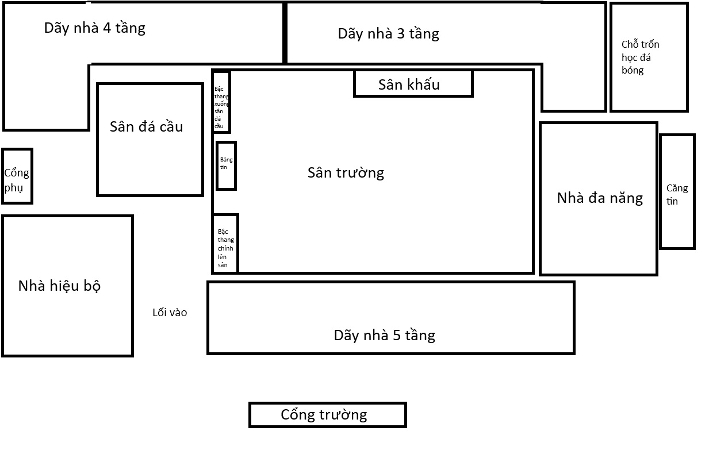
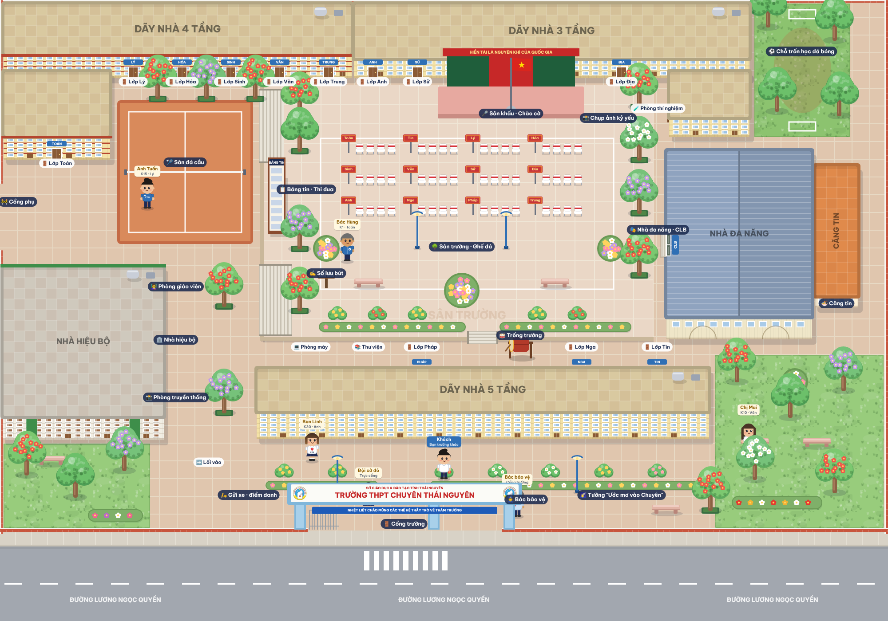

# Tài liệu thiết kế – Trường THPT Chuyên Thái Nguyên · Họp lớp online

| | |
|---|---|
| Phiên bản | 2.8 – tìm bạn cũ (Facebook/Zalo tuỳ chọn), phòng chat riêng của khóa và lớp, mời bạn bằng link + mã QR + thiệp mời, trang trí theo mùa và thời tiết |
| Tài liệu yêu cầu | [YEU-CAU.md](YEU-CAU.md) – mã yêu cầu `YC-…` được dẫn lại trong tài liệu này |
| Nhánh | `claude/thpt-chuyen-thai-nguyen-srs08f` |
| Sản phẩm tham khảo | [thpt.chuyenhalong.workers.dev](https://thpt.chuyenhalong.workers.dev/) |
| Nền tảng | Trình duyệt (điện thoại là chính) · Cloudflare Workers + D1 |

---

## 1. Mục tiêu và phạm vi

Một **sân trường ảo** dựng lại cơ sở cũ của THPT Chuyên Thái Nguyên tại **234A đường Lương Ngọc Quyến,
TP Thái Nguyên** (1995–2019). Mục tiêu, phạm vi, người dùng và toàn bộ yêu cầu xem [tài liệu yêu cầu](YEU-CAU.md).
Tài liệu này mô tả **cách hiện thực**.

**Nguyên tắc thiết kế**

| # | Nguyên tắc | Lý do |
|---|---|---|
| NT-1 | Không bước build, không thư viện ngoài: HTML + ES modules + Canvas 2D | Nhẹ, ai cũng sửa được, triển khai là chép file (YC-PN-03) |
| NT-2 | Nghiệp vụ viết **một lần** trong `logic.js`, chạy cả trên Worker lẫn trình duyệt | Chế độ ngoại tuyến và kiểm thử miễn phí (YC-PN-06, YC-PN-13) |
| NT-3 | Sơ đồ là **dữ liệu** (`campus.js`), không lẫn vào mã vẽ | Sửa sơ đồ theo trí nhớ cựu học sinh mà không đụng logic (YC-SD-13) |
| NT-4 | Đồng bộ bằng hỏi định kỳ (polling) thay vì WebSocket | Chạy được trên gói miễn phí, đơn giản (YC-PN-07) |
| NT-5 | Nội dung người dùng chỉ gắn bằng `textContent` | Chống chèn mã (YC-PN-09) |
| NT-6 | Mỗi không gian là một **cảnh** (`scene`) cùng một giao diện: kích thước, vật cản, điểm tương tác, chỗ ngồi, vẽ nền, vẽ vật thể | Thêm phòng mới (lớp học, thư viện…) mà không sửa lõi `World` (YC-LH-01) |

## 2. Người dùng

| Vai (`role`) | Mô tả | Cần khai báo | Ghi chú |
|---|---|---|---|
| `cuuhs` – Cựu học sinh | Đã ra trường | Tên, khóa, lớp chuyên | Nhóm chính |
| `hs` – Học sinh | Đang học | Tên, khóa, lớp chuyên | |
| `gv` – Thầy cô | Đang/đã công tác | Tên | Có phòng giáo viên |
| `khach` – Bạn trường khác | THPT khác | Tên, trường (tuỳ chọn) | |
| `em` – Em cấp 2 | THCS tham quan | Tên, trường (tuỳ chọn) | Viết tường "Ước mơ vào Chuyên" |
| Khách chưa ghi danh | Chỉ xem | – | Đi dạo, xem lưu bút, thấy người online; không được ghi |

Lớp chuyên: Toán, Tin, Lý, Hóa, Sinh, Văn, Sử, Địa, Anh, Nga, Pháp, Trung. Khóa ghi dạng `K1`…`K99`.

## 3. Sơ đồ khuôn viên

Sơ đồ dựng theo **bản vẽ tay của cựu học sinh** (`docs/so-do-goc.jpg`) và ảnh chụp cổng trường, nhà hiệu bộ,
dãy 4 tầng. Mỗi pixel của bản vẽ gốc = **1,6 px thế giới**. Thế giới rộng **2000 × 1400 px**, hướng Bắc ở trên,
đường Lương Ngọc Quyến ở dưới. Toàn bộ dữ liệu nằm trong `public/js/campus.js`.

| Bản vẽ gốc | Bản trong game |
|---|---|
|  |  |

```
┌──────────────────────────────┬──────────────────────────────────┬──────────┐
│ DÃY NHÀ 4 TẦNG (chữ L)       │ DÃY NHÀ 3 TẦNG    [sân khấu]     │ CHỖ TRỐN │
│ ┌────┐ (hàng cây phượng)     │                          ┌───────┤ HỌC ĐÁ   │
│ │    │  ┌──────────┐ ║┌──────┴───────────────────┐      │       │ BÓNG     │
│ └────┘  │ SÂN ĐÁ   │ ║│                          │      └───────┘          │
│CỔNG PHỤ │   CẦU    │ ▤│       SÂN TRƯỜNG         │ ┌──────────┐ ┌──┐      │
│         └──────────┘ ║│      (cao hơn mặt đất)   │ │ NHÀ ĐA   │ │CĂ│      │
│┌──────────┐          ║└──────────────────────────┘ │ NĂNG     │ │NG│      │
││ NHÀ      │  Lối  ┌──────────────────────────────┐ └──────────┘ │TIN      │
││ HIỆU BỘ  │  vào  │       DÃY NHÀ 5 TẦNG         │                         │
│└──────────┘       └──────────────────────────────┘       (cây xanh)        │
│                       [ CỔNG TRƯỜNG ]                                       │
└─────────────────────────┘         └───────────────────────────────────────┘
══════════════════════════ ĐƯỜNG LƯƠNG NGỌC QUYẾN ═══════════════════════════
 ║ bậc thang   ▤ bảng tin
```

| Hằng số | Nội dung |
|---|---|
| `FLOWERBEDS` | Bồn hoa tròn (`round`, `r`) hoặc chữ nhật, tuỳ chọn bảng màu `colors`; là vật cản |
| `BENCHES`, `SEATS` | Ghế đá và chỗ ngồi sinh từ ghế (2 chỗ/ghế) |
| `GROUNDS` | Mặt đất: đường, vỉa hè, sân bê tông, bãi cỏ, sân đá cầu (`court`), sân trường (`yard`) |
| `BUILDINGS` | Toà nhà: `id, name, short, x, y, w, h, floors, wall, roof` + tuỳ chọn `trim` (lan can đỏ dãy 4 tầng), `bands` (dải xanh nhà hiệu bộ), `hall` (mái nhà đa năng). Nhà chữ L tách thành nhiều khối cùng `id`; chỉ khối có `short` mới vẽ tên |
| `YARD`, `STAIRS`, `EDGES` | Sân trường cao; hai bậc thang ở cạnh trái (xuống sân đá cầu, bậc thang chính); tường chắn là vật cản, chừa chỗ bậc thang |
| `WALLS`, `GATE`, `SIDE_GATE` | Tường rào thấp màu kem, cổng chính (x 693–1130), cổng phụ bên trái |
| `CLASS_DOORS` | Cửa lớp: lớp chuyên nào ở dãy nào, vị trí đứng trước cửa |
| `HOTSPOTS` | Điểm tương tác: toạ độ, biểu tượng, nhãn, nhãn ngắn trên bản đồ (`map`), bảng cần mở (`panel`) |
| `TREES` (`tree` + `bloom`: `phuong`/`banglang`/`hoasua`, `planter`: bồn gốc cây; `bonsai`: bụi hoa; `palm` vẫn vẽ được), `LAMPS`, `FLAG`, `BOARD`, `STAGE`, `DRUM` | Trang trí; gốc cây, bảng tin, bục sân khấu là vật cản |

Lối đi chính: cổng → khoảng sân trước dãy 5 tầng → **lối vào** giữa nhà hiệu bộ và dãy 5 tầng → **bậc thang
chính** lên sân trường. **Lối đi giữa** (x 1052–1122): dải bồn hoa mép sân **chia đôi** đúng chỗ trống trường, mép sân hở và có **bậc thang
giữa** (`dir: 's'`) xuống hành lang trước mặt trong dãy 5 tầng (nơi có cửa lớp Pháp, Nga, Tin, thư viện, phòng máy);
dãy 5 tầng giữ nguyên một khối. Trống trường dời sang cạnh phải bậc thang (x 1172); cửa lớp Nga, Tin dời sang phải
(x 1310, 1480) để nhãn không chồng nhau. **Lối xuống căng tin**: nhà đa năng (y 400–790) và căng tin (y 430–750)
lùi xuống, chừa lối đi rộng ~90 px giữa dãy 3 tầng và nhà đa năng, từ mép phải sân trường sang thẳng cửa căng tin (đầu
trên) và chỗ trốn học; cửa nhà đa năng ở mặt trái (y 595) quay ra sân trường.

Phân bổ lớp (theo cựu học sinh, `CLASS_DOORS`): **dãy 4 tầng** trái → phải – Toán (chân chữ L), rồi Lý, Hóa, Sinh,
Văn, Trung cách đều nhau, cây phượng – bằng lăng có bồn đứng xen giữa; **dãy 3 tầng** trái → phải – Anh, Sử, Địa; **dãy 5 tầng** phải → trái – Tin, Nga, Pháp, cửa ở **mặt trong**
(quay vào sân trường), đi theo hành lang dưới chân tường sân, vào từ lối vào hoặc từ phía nhà đa năng.

### 3.1 Cảnh và lớp học

`World` luôn hiển thị **một cảnh**. Cảnh là object:

```js
{ id, name, w, h, bgColor, fit?, fitMin?, // fit: thu nhỏ cho vừa chiều ngang (không nhỏ hơn fitMin)
  solids: [{x,y,w,h}],                    // vật cản → lưới va chạm 20 px riêng của cảnh (class Grid, có cache)
  hotspots: [...], seats: [{x,y,dir,back}], // hotspot: {id,x,y,icon,label,panel,small?,rect?,nolabel?}
  spawn: {x,y},
  drawBg(ctx),                            // nền tĩnh, vẽ một lần vào canvas ngoài màn hình
  statics(ctx, now) → [{ y, draw() }] }   // vật thể sắp theo y cùng nhân vật
```

| Cảnh | Nguồn | Ghi chú |
|---|---|---|
| `campus` | `CAMPUS_SCENE` trong `world.js`, dữ liệu `campus.js` | 2000 × 1400, 30 điểm tương tác, 20 chỗ ngồi ghế đá |
| `lop:<Lớp>` | `classroomScene(lop)` trong `classroom.js` | 640 × 980 (dọc, hợp điện thoại): tường đầu lớp có **Nội quy lớp học**, **bảng lớp** (thứ/ngày, tên lớp), **5 điều Bác Hồ dạy**, khẩu hiệu, đồng hồ; bục giảng + bàn giáo viên (sổ đầu bài); 6 × 3 bàn, **36 chỗ ngồi** (quay lưng, hướng lên bảng); hành lang bên trái có lan can, chậu hoa, **ban công**, cửa sau; cửa sổ hai bên; cửa **ra sân** ở góc phải đầu lớp; giá sách **lưu bút lớp** ở cuối lớp; `fit: true, fitMin: 0.6` |

Vào lớp: chạm nhãn "🚪 Lớp …" **hoặc chạm thẳng vào cánh cửa / biển tên lớp trên mặt tiền** (hotspot có `rect`,
vùng chạm theo toạ độ thế giới) → nhân vật đi tới cửa → `panel: 'enterClass'` → `world.setScene(classroomScene(lop), spawn)`,
nhớ vị trí cửa trong `classReturn`. Cửa mặt nam vẽ trong `statics` (sau toà nhà) gồm khung trắng, cánh gỗ và biển
tên lớp màu xanh; cửa mặt trong dãy 5 tầng có biển tên trên lối đi.

Trong lớp: bảng, hai tờ áp phích không có nhãn (`nolabel`) vì đã có chữ – chạm thẳng vào đồ vật (`rect`). Camera của
cảnh `fit` không lộ khoảng tối ngoài phòng và tính phần bị thanh trên/thanh chat che (`world.insets`, đo từ DOM khi
đổi kích thước) để thấy trọn tường đầu và cuối lớp.

| Điểm trong lớp | Mở |
|---|---|
| 🖍️ Bảng lớp | Menu: ✍️ Lưu bút lớp · 📒 Sổ đầu bài · ❓ Đố vui · 🙋 Kiểm tra bài cũ · 📓 Kiểm tra vở ghi · 📤 Nộp sổ đầu bài |
| 📋 Nội quy, ⭐ 5 điều Bác Hồ dạy | Danh sách đánh số (`CLASS_RULES`, `BAC_HO` trong `logic.js`) |
| 📒 Bàn giáo viên | Sổ đầu bài |
| ✍️ Giá sách cuối lớp | Lưu bút lớp theo khóa, danh sách cả lớp theo khóa, đố vui |
| 🌤️ Ban công | Thông báo + nhân vật nói một câu |
| 🚪 Ra sân | Về sân, đứng trước cửa lớp |
| Cô chủ nhiệm (NPC) | Đi lại trước bảng; chạm → kiểm tra bài cũ |

**Sổ đầu bài** (theo lớp chuyên, theo ngày đổi lúc 5 giờ sáng):
- *Có mặt*: ngồi vào ghế trong lớp mình (thầy cô, khách: lớp bất kỳ) → `act classSit` ghi tên + giờ vào sổ.
- *Ghi chú buổi học*: học sinh lớp đó / thầy cô viết ≤ 200 ký tự, mỗi người một ghi chú mỗi ngày.
- *Kiểm tra vở ghi*: có ghi chú hôm nay → cô khen, +5 điểm (mỗi ngày một lần); chưa có → nhắc đi ghi bài.
- *Nộp sổ*: người đầu tiên trong ngày +10 điểm; người sau thấy ai đã nộp, lúc mấy giờ.
- *Điểm miệng*: kết quả "Kiểm tra bài cũ" ghi vào sổ (`score` với `game: 'baicu', lop`).
- *Ghi tên vi phạm*: ném bóng nước trúng người trong lớp **giữa giờ học** (tiết 1–10 theo `periodOf`) → tự động
  ghi tên; thầy cô ghi tên học sinh có mặt kèm lý do. Bị ghi tên thì lần điểm danh ngày hôm sau **không được tiền
  ăn vặt** (`checkin` trả `punished: true`).
- Xem lại các ngày trước bằng ô chọn ngày (30 ngày gần nhất có ghi chép). Ra lớp (`exitClass`, mở bản đồ, "Về cổng trường") → `setScene(CAMPUS_SCENE, classReturn)`.
`setScene` dựng lại nền, lưới va chạm, xoá người khác và hiệu ứng, đặt lại mức phóng to, gọi `onSceneChange`.
Vị trí chỉ được lưu vào `localStorage` khi đang ở sân trường.

Mỗi lượt `presence` gửi kèm `scene`; máy khách chỉ hiện những người có cùng `scene`, nên ai đang trong lớp Toán
chỉ thấy người cũng trong lớp Toán (mọi khóa). Số người online trên thanh trên vẫn đếm toàn trường.

### 3.2 Các phòng bên trong (`rooms.js`)

Giống trang mẫu, các phòng là cảnh riêng. Hàm `room()` dựng khung chung: sàn ô, tường trên 96 px có biển tên,
tường hai bên có cửa sổ, tường dưới có **cửa "Ra sân"** ở giữa (hotspot `exitRoom`); `thing()` thêm đồ vật có vật cản
và vẽ theo thứ tự y; `tableWithSeats()` thêm bàn kèm ghế ngồi được (ghế phía trên nhìn ra người xem, phía dưới
quay lưng). Mỗi phòng có `spots` (điểm xuất hiện theo cửa đã vào) và `zone` (tính "ghé khu").

| Cảnh | Cửa ngoài sân | Kích thước | Bên trong | Nhân vật |
|---|---|---|---|---|
| `p:thuvien` 📚 Thư viện | `library` (dãy 5 tầng) | 640 × 660 | 2 giá sách trên tường, 2 giá dọc tường, 4 bàn đọc (16 ghế), bàn thủ thư → `library`, giá báo → `newsRack` | Cô Hạnh (thủ thư) |
| `p:phongmay` 💻 Phòng máy | `computer` | 640 × 660 | Màn chiếu bài Pascal, nội quy, điều hoà, bàn thầy, 6 bàn × 3 máy CRT (18 ghế); Dò mìn → `domin`, kỷ niệm → `computer` | Thầy Quang (Tin) |
| `p:phongtn` 🧪 Phòng thí nghiệm | `lab` (dãy 3 tầng) | 640 × 660 | Tủ hoá chất, bảng tuần hoàn, tủ hút khí độc, bàn thầy → `hoahoc`, 4 bàn thí nghiệm có bồn rửa (8 ghế đẩu), vòi rửa mắt | Thầy Minh (Hóa) |
| `p:hieubo` 🏛️ Nhà hiệu bộ | `office`, `teachers`, `history` | 640 × 760 | Bảng thông báo họp lớp → `office` tab 0, phòng truyền thống → `history`, tủ cúp **bảng vàng đội tuyển** → `honor` (lưu bút `doituyen`), gian Tri ân → `office` tab 1, Phòng giáo viên → `teachers`, Phòng cấp bằng → `office` tab 2 | Cô Lan (văn phòng) |
| `p:cangtin` 🍜 Căng tin | `canteen` (cửa ở đầu trên căng tin, x 1884 y 412, quay ra lối đi giữa dãy 3 tầng và nhà đa năng; `doorN` vẽ mái hiên sọc) | 560 × 720 | Bảng thực đơn (từ `MENU`), quầy → `canteen`, 5 bàn tròn (10 ghế đẩu), tủ nước, biển giảm giá giờ ra chơi | Cô căng tin, anh Dũng (ngồi) |
| `p:dana` 🏀 Nhà đa năng · CLB | `clubs` (cửa mặt trái, x 1482 y 595, quay ra sân trường; `doorW` trên toà nhà vẽ cửa đôi, tam cấp, biển CLB) | 640 × 860, cửa ở tường trái (`room({ door: 'w', doorY: 477 })`) | Bảng tỉ số, nửa sân bóng rổ có rổ → `bongro`, 6 gian CLB → `club` (lưu bút `clb:<id>`) | Bạn Nam |

Vào phòng: `panels.enterRoom(hs)` (hotspot có `room`, `spot`) → `ROOMS[room]()`, nhớ cửa trong `classReturn`, thay nhân
vật phụ bằng `campusNpcs` + `roomNpcs(id)`, `setScene(sc, sc.spots[spot])`, `visitZone(sc.zone)`. Ra: `exitRoom` →
`backToCampus()`. Đồ vật có chữ (gian CLB, quầy trong nhà hiệu bộ) dùng `nolabel` + `rect` để chạm thẳng.

### 3.3 Ngồi ghế

Chỗ ngồi là điểm `{x, y, dir, back}` của cảnh (ghế đá: 2 chỗ/ghế, nhìn ra phía người xem; ghế lớp: quay lưng).
Chạm gần chỗ ngồi (≤ 24 px) → `walkTo(seat, { sit })` → tới nơi thì `sitOn(seat)`: đặt `me.sit`, xoay theo `dir`.
Bất kỳ chuyển động nào (chạm sân, phím, ném bóng) xoá `me.sit`. `avatar.js` vẽ tư thế ngồi: hạ thân, đùi gập,
cẳng chân thõng trước ghế (nhìn thẳng) hoặc chỉ thấy lưng (quay lưng). Trạng thái ngồi đi theo `presence`
(`sit`, `sitBack`, `dir`) để người khác cùng thấy.

## 4. Chức năng

| Địa điểm | Bảng (`panel`) | Chức năng | Cần ghi danh |
|---|---|---|---|
| Cổng trường | `gate` | Giới thiệu cơ sở cũ, hướng dẫn | Không |
| Bác bảo vệ | `guard` | Câu thoại ngẫu nhiên | Không |
| Gửi xe (trái cổng) | `parking` | Điểm danh mỗi ngày: +20.000đ vào ví, +2 điểm | Có |
| Bảng tin | `board` | Bảng thi đua theo khóa, theo lớp chuyên, đá cầu | Không |
| Sân khấu (cột cờ ở giữa) | `stage` | "Hiền tài là nguyên khí của quốc gia", lưu bút chào cờ/văn nghệ | Ghi: có |
| Trống trường (giữa dãy 5 tầng, sát sân) | `drum` | Xem giờ/tiết, đánh trống (âm thanh Web Audio) | Không |
| Nút 🎈 (mọi nơi) | – | Danh sách người cùng cảnh để chọn ném bóng nước | Thấy được bởi người khác: có |
| Thẻ người chơi | – | Vẫy tay, ném bóng nước, viết sổ lưu bút, đi tới | Một số: có |
| Nhân vật của tôi | – | Đổi kiểu, sổ lưu bút của tôi, album kỷ yếu, mã khôi phục | Có |
| Nút 🎵 (thanh trên) | – | Nhạc nền 3 bài: đang phát / tạm dừng, ⏮ ⏯ ⏭, âm lượng (không hiện tên bài) | Không |
| Sân trường · ghế đá | `garden` | Lưu bút tâm sự | Ghi: có |
| Nhà hiệu bộ | `office` | Lịch họp lớp (tạo, đăng ký/huỷ), thiệp tri ân thầy cô | Ghi: có |
| Phòng giáo viên | `teachers` | Lưu bút `gv` | Ghi: có |
| Phòng truyền thống | `history` | Mốc lịch sử cơ sở, góc kỷ niệm | Ghi: có |
| Cửa lớp | `enterClass` | Vào cảnh lớp học | Không |
| Trong lớp: bảng đen / bàn giáo viên / tủ sách | `class` (tab 2 / 1 / 0) | Đố vui · Sổ đầu bài · Lưu bút lớp, chọn khóa | Ghi: có |
| Trong lớp: cửa ra | `exitClass` | Về sân, đứng trước cửa lớp | Không |
| Chụp ảnh kỷ yếu (trước sân khấu, nút 📸) | `photo` | Đếm ngược, khung kỷ yếu, lưu về máy, đăng album | Đăng: có |
| Sân đá cầu | `football` | Trò đá cầu + bảng xếp hạng | Lưu điểm: có |
| Nhà đa năng | `clubs` | Gian từng CLB, mỗi gian một lưu bút | Ghi: có |
| Căng tin | `canteen` | Thực đơn, mua/đãi bạn, giảm 20% giờ ra chơi | Có |
| Chỗ trốn học đá bóng | `tronhoc` | Lưu bút "tự thú" | Ghi: có |
| Cổng phụ | `sidegate` | Lưu bút chuyện cổng phụ | Ghi: có |
| Tường ước mơ | `wish` | Lưu bút "Ước mơ vào Chuyên" | Ghi: có |
| Lối vào | `entry` | Gợi ý đường lên sân trường | Không |
| Nhân vật của tôi (nút ảnh đại diện) | `mirror` | Đổi tên, kiểu tóc, đồng phục | Có |

**Điểm thi đua** (`POINTS` trong `logic.js`): điểm danh +2, lưu bút +5, tạo họp lớp +3, đăng ký họp lớp +3,
mỗi câu đố đúng +1 (tối đa 10 điểm/ngày), đá cầu từ 5 quả +1. Điểm của khóa/lớp = tổng điểm thành viên.

**Thời khoá biểu** (giờ Việt Nam, `SCHEDULE`): sáng 5 tiết từ 7:00, ra chơi 9:25–9:45; chiều 5 tiết từ 13:30,
ra chơi 15:55–16:15. Dùng cho đồng hồ trên thanh trên và giảm giá căng tin.

## 5. Giao diện

### 5.1 Bố cục màn hình chính (điện thoại)

```
┌──────────────────────────────────────┐
│ [CTN] Sân trường    ●3 🎵 💰20k 🙂    │  ← khu vực · giờ · tiết; online; nhạc; ví / Ghi danh
│       14:07 · Tiết 1 chiều            │
├──────────────────────────────────────┤
│                                      │
│        canvas sân trường             │  ← chạm để đi, chạm nhãn để mở
│ ┌─────────┐                     (🎈) │  ← ném bóng nước
│ │▶ nhạc   │                      (+) │
│ └─────────┘                      (−) │  ← trình phát nhạc nhỏ (khi bật 🎵)
├──────────────────────────────────────┤
│ [Xin chào!👋] [Lâu quá không gặp!] … │  ← câu nói nhanh + 😂 ❤️ 👍 (cuộn ngang)
│ (🗺️)  Nhắn gì đó…                (➤) │  ← bản đồ toàn trường, ô chat
└──────────────────────────────────────┘
```

Các bảng chức năng mở dạng **sheet trượt từ dưới lên** (trên máy tính hiện ở giữa), đóng bằng ✕, chạm nền
hoặc phím Esc.

### 5.2 Luồng ghi danh

```
Mở trang ──► Sân trường (khách) + bảng "Chào mừng"
               ├─ Chọn vai ─► Thông tin ─► Chọn ngoại hình ─► Tên hiển thị ─► Lưu mã khôi phục ─► Vào sân
               ├─ "Tôi đã có nhân vật" ─► nhập CTN-XXXX-XXXX ─► Vào sân
               └─ "Vào xem với tư cách khách" ─► Vào sân (chỉ xem)
Khách bấm chức năng cần ghi danh / ô chat ─► mở lại bảng "Chào mừng"
```

| Bước | Nội dung |
|---|---|
| Bạn là ai? | Logo, 3 nhân vật mẫu, "Chào mừng bạn về Trường THPT Chuyên Thái Nguyên!", 5 vai (biểu tượng + mô tả), "Tôi đã có nhân vật", "Vào xem với tư cách khách" |
| Thông tin | Cựu học sinh / học sinh: **Khóa của bạn** (ô chọn K40 → K1) + **Lớp chuyên** (12 nút); thầy cô: **Danh xưng** Thầy/Cô (đặt sẵn giới tính) + **Bộ môn hoặc phòng ban**; bạn trường khác / em cấp 2: **Tên trường**. Thiếu khóa/lớp thì báo "Bạn chọn khóa nhé" / "Bạn chọn lớp nhé" |
| Chọn ngoại hình | Bộ chọn ở 5.3 |
| Tên hiển thị | Nhân vật xem trước, dòng tóm tắt (`K20 · Hóa`, `Thầy · Vật lý`, tên trường), ô tên (≥ 2 ký tự mới bấm được "Vào sân trường") |
| Lưu mã khôi phục | Mã, nút sao chép, cảnh báo không gửi mã cho người khác, "Tôi đã lưu, vào sân trường" |

Thầy cô: danh xưng và bộ môn lưu vào trường `school` (vd `Cô · Toán`) và hiện ở dòng thứ hai của thẻ tên.

### 5.3 Nhân vật

Vẽ bằng canvas (`avatar.js`) kiểu **chibi**: đầu to (≈ 45 % chiều cao), mắt tròn có ánh sáng, má hồng, miệng cười,
nữ có mi mắt; tay tròn; áo có viền. Hoạt ảnh thở nhẹ khi đứng, bước chân/vung tay khi đi, quay trái/phải, quay lưng
khi đi lên, ngồi (nhìn thẳng hoặc quay lưng). Thẻ tên hai dòng: tên + `K20 · Toán` (thẻ của mình màu đỏ).

**Bộ chọn ngoại hình** (`avatarEditor(look, role)` trong `main.js`, dùng khi tạo nhân vật và khi soi gương đổi kiểu):
khung xem trước có hoạt ảnh (`avatarStage`) + nút **🎲 Ngẫu nhiên** (`randomLook`, giữ trang phục đang chọn),
rồi lần lượt: **Giới tính** (👦 Nam / 👧 Nữ) · **Màu da** (5 ô màu) · **Kiểu tóc** · **Màu tóc** (8 ô màu) ·
**Kiểu dáng** Quần/Váy (chỉ nữ) · **Trang phục** (theo vai) · **Màu áo lớp** (khi chọn áo lớp). Nút đang chọn tô xanh.

| Thuộc tính | Giá trị |
|---|---|
| Kiểu tóc (13) | Ngắn, Rẽ ngôi, Tóc bob, Đuôi ngựa, Tóc dài, Búi cao, Rẽ ngôi 3/7, Đan Trường, Mullet, Undercut, Short quiff, Layer, Hai bím. Đổi sang nam thì các kiểu chỉ dành cho nữ (bob, đuôi ngựa, tóc dài, búi cao, layer, hai bím) về "Ngắn" |
| Màu tóc (8) | Đen, Nâu, Xám, Bạc, Đỏ, Tím, Balayage (chuyển màu nâu đậm → vàng), Cam |
| Màu da (5) | `#FBDDC2` `#F1C39B` `#D9A066` `#B97C4E` `#8E5C3A` |
| Trang phục – cựu HS, HS | **Áo khoác đồng phục** (mặc định) · Sơ mi cà vạt · Áo lớp (6 màu) · Áo dài kỷ yếu (nữ) / Vest kỷ yếu (nam) · Áo "Tôi yêu CTN" trắng/đen |
| Trang phục – thầy cô | Sơ mi trắng/xanh/vàng · nữ: Áo dài tím/hồng/xanh/đỏ, nam: Vest · Áo "Tôi yêu CTN" |
| Trang phục – bạn trường khác | Sơ mi trắng · Áo khoác (xanh, `khoacxanh`) · Áo phông · Áo dài trắng (nữ) / Vest (nam) · Áo "Tôi yêu CTN" |
| Trang phục – em cấp 2 | Khăn quàng đỏ · Áo "Tôi yêu CTN" |

**Áo khoác đồng phục** (`khoac`, theo ảnh áo thật của trường): thân trắng, vai và ngực trên xanh da trời `#5DBDEB`, dải chữ V
xanh than `#1E2E6B` ngang ngực, cổ đứng xanh than, khoá kéo giữa, logo trường tròn trên ngực trái; tay áo trắng, vai xanh,
hai sọc đỏ `#D8343A` + xanh than dọc mép ngoài, bo tay xanh; quần sẫm `#23262F` (nữ chọn được chân váy). Mặt sau giữ mảng
màu vai và dải V.

Ngoại hình lưu dạng `{v: 2, gender, skin, hair, hairColor, bottom, outfit, color, scarf}`. Nhân vật tạo trước bản 1.7
(9 kiểu tóc, 5 màu tóc, có cặp sách) được đổi sang kiểu gần nhất ở cả máy chủ (`sanitizeLook`) lẫn trình duyệt
(`normLook`), nên người chơi cũ vẫn thấy nhân vật của mình gần như cũ.

### 5.4 Âm thanh và hiệu ứng

| Thành phần | Thiết kế | Yêu cầu |
|---|---|---|
| Nhạc nền 🎵 | `music` trong `main.js`: một phần tử `Audio`, danh sách `PLAYLIST` (3 file trong `public/music/`). Sự kiện `ended` → bài kế tiếp, sau bài cuối quay về bài đầu; `error` → bỏ qua bài lỗi. `autostart()` gọi khi vào trường; nếu trình duyệt chặn tự phát thì nghe `pointerup`, `touchend`, `click`, `keydown` (các sự kiện được tính là thao tác người dùng – iOS Safari không tính `pointerdown`/`touchstart` của cảm ứng) và gọi `play()` ngay trong lúc xử lý, chưa được thì thử tiếp ở lần sau. Tạm dừng lưu `ctn.musicOff` trong `sessionStorage` (chỉ lần truy cập đó). Bảng 🎵 không hiện danh sách bài và tên bài (tên chỉ nằm trong `PLAYLIST` để quản lý file). Âm lượng = `settings.music / 100`. Đổi bài: sửa `PLAYLIST` | YC-AT-02, YC-AT-03 |
| Trống trường 🥁 | `beatDrum()`: 3 nhịp, mỗi nhịp một `OscillatorNode` sóng sine trượt 110 → 45 Hz trong 0,4 s, âm lượng tắt dần theo hàm mũ. `AudioContext` chỉ tạo khi người dùng bấm | YC-HD-09 |
| Bóng nước 🎈 | `World.throwBalloon`: quỹ đạo nội suy tuyến tính + cung `sin(πk)`, thời gian bay `450 + khoảng cách × 1,3` ms, bám theo vị trí hiện tại của mục tiêu; khi chạm: vòng nước + 10 giọt bắn trong 0,7 s; đặt `wet[id]` 4 s → `_wetFx` vẽ giọt nước rơi quanh người | YC-OL-07 |
| Bong bóng lời nói | `World.say(id, text)`: hiện 5 s trên đầu, cắt bớt chữ quá dài | YC-OL-05 |
| Khung chat chung 💬 | `presence` có `say` → `postChat` lưu tin vào bảng `chat` (kèm tên, vai, khóa, lớp, trường, khu) và cập nhật `chatlast`; mỗi lượt `presence`/`online` gửi `chatAfter` (thời điểm tin cuối đã có) → `chatSince` trả tin mới (tối đa 30; chỉ đọc danh sách khi `chatlast` mới hơn). Giữ khoảng 100–120 tin. Trình duyệt hiện tin của mình ngay khi gửi, giữ 50 dòng, cuộn theo tin mới, thu gọn được (`ctn.chatMin`), đếm tin chưa đọc khi thu gọn. Dòng: **tên** + `subOf` (khóa · lớp…) + nội dung | YC-TT2-15 |

Đồng bộ cú ném: người ném đặt `pendingThrow = {x, y, target}` và gửi kèm lượt `presence` kế tiếp. Máy chủ lưu
`throw` (kèm `at`) trong bản ghi presence 6 giây. Máy khác thấy `throw.at` mới thì diễn lại cú ném từ vị trí người
ném tới mục tiêu; nếu `target` là id của mình thì hiện thông báo "… vừa ném bóng nước trúng bạn!". Lần đầu thấy một
người, cú ném cũ hơn 4 giây bị bỏ qua để không diễn lại chuyện đã qua.

```
Người ném (A)            Máy chủ (presence)              Người bị ném (B)
   │ bấm 🎈                    │                               │
   │ diễn hoạt ảnh ngay        │                               │
   │── presence {throw} ──────►│ lưu throw.at (giữ 6 s)        │
   │                           │◄────────── presence ──────────│ (≤ 2,5 s sau)
   │                           │── others[A].throw ───────────►│ throw.at mới → diễn lại,
   │                           │                               │ target = B → ướt + thông báo
```

### 5.5 Sổ lưu bút

`bookSheet(owner)` dùng phòng lưu bút `so:<id chủ sổ>` (API `guestbook`/`sign` sẵn có). Trang 0 là bìa (logo, tên
chủ sổ, số trang), trang 1…n là từng lời lưu bút theo thứ tự cũ → mới, trang n+1 là trang viết. Giấy kẻ dòng
28 px bằng `repeating-linear-gradient`, lề đỏ, chữ viết tay **Pangolin** (Google Fonts, có tiếng Việt), rơi về
Be Vietnam Pro nếu không tải được font.

### 5.6 Ảnh kỷ yếu

```
📸 Chụp → đếm ngược 3·2·1 (presence: "📸 Cười lên nào!")
       → world.capture(640, 404, zoom 1.6): vẽ lại cảnh quanh nhân vật vào canvas riêng, bỏ nhãn/đường đi
       → composeYearbook(): khung 720 × 660 – viền xanh than, chỉ vàng, logo tròn, "KỶ YẾU",
         tên trường, ngày, khóa · lớp, ảnh, lời ghi (Pangolin), tên người trong ảnh (≤ 260 px quanh mình)
       → JPEG: ảnh lớn ≤ 720 px (≤ 290 KB base64), ảnh nhỏ 240 px (≤ 38 KB)
       → ⬇️ lưu về máy (<a download>) | 🖼️ albumPost {full, thumb, caption, people}
```

`world.capture` tạm thay `ctx`, kích thước, camera của `World` rồi gọi `_draw` với cờ `_capturing`, sau đó khôi phục.
Logo là file cùng nguồn nên canvas không bị "nhiễm bẩn" và xuất được JPEG.

### 5.6b Tải ảnh lên làm ảnh kỷ yếu

Bảng 📸 có hai cách: **Chụp ở sân** (như trên) hoặc **Tải ảnh lên** (`<input type=file accept=image/*>`).
`readPhoto(file)` dùng `createImageBitmap(file, { imageOrientation: 'from-image' })` để xoay đúng chiều theo EXIF (không
hỗ trợ thì dùng `Image`), thu nhỏ cạnh dài ≤ 1400 px. `composeYearbook` nhận ảnh tỉ lệ bất kỳ: khung ảnh rộng 632 px, cao
theo tỉ lệ ảnh trong khoảng 300–820 px, ảnh phủ kín khung và cắt phần thừa ở giữa. Tên người trong ảnh lấy từ ô nhập (cách
nhau bởi dấu phẩy), bỏ trống thì là tên mình. Ảnh chỉ rời máy khi bấm "Đăng lên album" (JPEG ≤ 290 KB, ảnh nhỏ ≤ 38 KB).

### 5.6c Thầy cô chủ nhiệm và thầy cô phòng chức năng

Tên cô chủ nhiệm trong lớp mặc định lấy theo danh sách (`classNpcs`). Bảng `gvcn`, khóa `lớp|khóa` (`*` = chung), giá trị
`{lop, khoa, title, name, by, at}`. `setClassTeacher`: học sinh/cựu học sinh lớp đó ghi cho khóa mình; thầy cô ghi cho khóa
chọn hoặc `*`; người khác bị từ chối (403). Khi vào lớp, `loadTeacher` gọi `classTeacher` và chọn: tên của khóa mình → tên
chung → tên đặt gần nhất; "Thầy" thì nhân vật đổi sang dáng nam, sơ mi.

Cùng cơ chế cho thầy cô phòng chức năng: mỗi NPC có `slot` (`thuvien`, `phongmay`, `phongtn`, `hieubo`; với cô chủ nhiệm là
tên lớp) và `subject` (Thủ thư, Tin, Hóa, Văn phòng). Với phòng chức năng (`ROOM_TEACHERS` trong `logic.js`), học sinh/
cựu học sinh **lớp bất kỳ** sửa cho khóa mình; thầy cô sửa cho khóa bất kỳ; khách bị từ chối. Vào phòng thì `loadTeacher(slot)`.
`lookForTitle` đổi dáng theo danh xưng (Thầy → nam, sơ mi; Cô → nữ, áo dài nếu đang mặc vest).

### 5.6c2 Nhân vật phụ cấu hình được

Mọi nhân vật phụ có `slot`: ngoài lớp chuyên và 4 phòng chức năng còn `baove, codo, hung, mai, tuan, linh, cangtin, dung,
nam` (`OTHER_NPCS` trong `logic.js`). Với các nhân vật này, bản ghi `gvcn` có thêm `sub` (dòng phụ dưới tên, ≤ 30 ký tự)
và danh xưng lấy từ `NPC_TITLES` (Thầy, Cô, Bác, Chú, Anh, Chị, Bạn, Em, Ông, Bà) hoặc để trống; thầy cô vẫn chỉ Thầy/Cô.
Quyền sửa như phòng chức năng (học sinh/cựu học sinh lớp bất kỳ cho khóa mình, thầy cô cho mọi khóa). Trình duyệt gọi
`teachersAll` một lần khi vào trường và mỗi khi vào phòng (`loadNpcNames`) để đặt tên theo khóa mình; danh xưng nam
(Thầy, Chú, Anh, Ông) / nữ (Cô, Chị, Bà) đổi dáng nhân vật. Bảng quản trị có thêm nhóm "Nhân vật khác" với cột dòng phụ;
dán danh sách nhận cột thứ 5 là dòng phụ và tên nhân vật thường gọi (Bảo vệ, Cờ đỏ, Bác Hùng, Căng tin…).

### 5.6d Quản trị: sửa tên thầy cô hàng loạt

- **Mã quản trị**: biến bí mật `ADMIN_CODE` của Worker (`wrangler secret put ADMIN_CODE`; chạy thử trên máy: `.dev.vars`).
  Worker truyền `adminCode` và `ip` (`cf-connecting-ip`) vào `ctx`. Chế độ ngoại tuyến dùng mã `DEMO`
  (`OFFLINE_ADMIN_CODE` trong `api.js`). Chưa đặt mã thì mọi yêu cầu quản trị trả 503.
- `checkAdmin`: so sánh mã không phụ thuộc thời gian (`sameText`), đếm lần sai trong bảng `adminfail` (khóa `ip|giờ`);
  sai 10 lần trong một giờ thì trả 429 cho IP đó, kể cả mã đúng.
- `adminTeachers`: mỗi lần tối đa 40 tên (`ADMIN_BATCH`, vì D1 gói miễn phí giới hạn 50 truy vấn mỗi yêu cầu; trình duyệt
  tự chia đợt); mỗi mục `{lop, khoa, title, name}`, tên rỗng = xoá; dòng lỗi được báo lại, dòng đúng vẫn lưu; `by` = "Quản trị".
- Giao diện `adminTeachersSheet` (từ "Nhân vật của tôi", bảng sửa tên thầy cô, hoặc `/?quantri`): nhập mã (giữ trong
  `sessionStorage` của phiên), chọn **khóa áp dụng** (tất cả các khóa hoặc K1–K40), rồi
  - **📋 Bảng**: 16 dòng (12 lớp chuyên + thư viện, phòng máy, phòng thí nghiệm, văn phòng), mỗi dòng Thầy/Cô + họ tên,
    điền sẵn tên đang có; "Lưu tất cả" chỉ gửi dòng thay đổi;
  - **📝 Dán danh sách**: mỗi dòng `Lớp | Thầy/Cô | Họ tên | Khóa` (cột cách nhau bằng `|`, tab hoặc `;` – dán thẳng từ
    Excel/Google Sheets); lớp viết như trong game hoặc tên phòng (Thư viện, Phòng máy, Phòng thí nghiệm, Văn phòng);
    xem trước số dòng hợp lệ và dòng lỗi trước khi lưu.

### 5.6e Quản trị: tin nhắn và thành viên

- **Xoá tin**: `adminDeleteChat {code, ids}` / `adminPurgeChat {code, uid}` (mọi tin của một người, mỗi lần ≤ 30, trả
  `remaining` để gọi tiếp) → `deleteChat` xoá bản ghi `chat` và ghi id vào `chatlast.del` (200 id gần nhất) cùng `delAt`.
  Mỗi lượt `presence`/`online` gửi `chatDelAfter`; nếu `delAt` mới hơn, máy chủ trả `chatDel` (danh sách id) và
  `chatDelAt`, trình duyệt gỡ các dòng `[data-id]` tương ứng. Tin của chính mình hiện ngay lúc gửi (chưa có id) và được
  gắn id khi máy chủ trả về (`matchOwn`), nên cũng bị gỡ khi quản trị xoá.
- **Khoá**: `adminBan {code, uid, reason}` đặt `user.banned = {at, reason}`, xoá bản ghi `presence`. `auth()` và `recover`
  trả 403 kèm `{banned: true, reason}` cho người bị khoá → trình duyệt (`bannedNotice`) báo lý do, chuyển về chế độ khách,
  giữ token để tải lại vẫn bị khoá. `adminUnban` gỡ khoá.
- **Tìm thành viên**: chỉ mục gọn `uidx` (`{id, name, role, khoa, lop, school, at, banned}`) ghi khi đăng ký, đổi tên,
  khoá/mở khoá; nhân vật cũ được thêm vào chỉ mục ở lần `me` đầu tiên. `adminUsers {code, q, banned}` so tên không dấu
  (bỏ dấu tiếng Việt, đ → d), trả tối đa 50 người, người bị khoá gần nhất lên đầu.
- **Giao diện**: `adminSheet` có 3 mục (Tên thầy cô · Tin nhắn · Thành viên); `banForm` (lý do + "xoá luôn mọi tin nhắn"),
  không dùng `confirm()`; khung chat có lớp `admin` khi phiên quản trị đang mở → hiện nút ⋯ trên mỗi dòng (`adminMsgSheet`).

### 5.6f Quản trị: lưu bút và ảnh

- `adminDeleteGb {code, room, at, id}` dựng lại khóa `phòng|thời gian-id` từ chính lời lưu bút đang hiện; `adminDeletePhoto
  {code, id, at}` xoá `photo`, `photofull` và chỉ mục `photouid`.
- `adminPurgeContent {code, uid}`: quét bảng `gb` lấy lời của người đó (mỗi lần xoá ≤ 20), ảnh lấy từ chỉ mục `photouid`
  (`uid|thời gian-id`, ghi khi đăng ảnh) cộng ảnh trong 60 ảnh mới nhất (ảnh đăng trước khi có chỉ mục), mỗi lần ≤ 6 ảnh;
  trả `remaining` để trình duyệt gọi tiếp (`purgeContent`). Giới hạn mỗi lần để không vượt 50 truy vấn D1/yêu cầu.
- Giao diện: `gbItem` và trang sổ lưu bút thêm `adminDelGbBtn` khi `isAdmin()`; `photoView` thêm nút xoá ảnh; nút xoá cần
  bấm hai lần (không dùng `confirm()`). `banForm` có thêm "xoá luôn lưu bút và ảnh".

### 5.6g Bảng tin: lời chia tay của khóa + lời tri ân thầy cô

- Bảng `khoalt`, khóa `K20` → `{khoa, farewell, thanks, by, at, prev}` (`prev` = bản trước để khôi phục). `khoaLetter {khoa}`,
  `khoaLetters` (khóa nào đã viết) công khai; `setKhoaLetter {farewell, thanks}` chỉ cho cựu học sinh, ghi vào khóa của họ;
  `adminKhoaLetter {code, khoa, farewell, thanks | restore}` (để trống cả hai = xoá).
- Bảng tin (`panels.board`) đổi tên "📋 Bảng tin": với cựu học sinh, mục đầu là "📜 Khóa N" (lá thư của khóa mình), sau đó
  các mục thi đua; người khác có mục "📜 Lời chia tay" ở cuối với ô chọn khóa. `letterCard` vẽ lá thư (logo, tiêu đề
  "Lời chia tay khóa N", "Lời tri ân thầy cô", chữ Pangolin, người viết); khóa chưa viết dùng `defaultLetter(khoa)`.
  `letterEdit` cho cựu học sinh khóa đó viết lại. Mỗi phiên, cựu học sinh thấy banner nhắc kèm nút "Xem".
- Bảng quản trị có thêm mục "📜 Lời chia tay" (`adminLetterView`): chọn khóa, sửa, xoá, khôi phục bản trước, xem trước.

### 5.6h Tìm bạn cũ và liên hệ

- Chỉ mục `uidx` (phiên bản 2) thêm `look` và `c` (liên hệ) để lọc mà không đọc hồ sơ; nhân vật có chỉ mục cũ được ghi lại ở
  lần `me` đầu tiên (`u.ix < INDEX_VER`).
- `setContact {fb, zalo, note, vis}`: Facebook nhận link hoặc tên người dùng (`normFb` bỏ `https://www.facebook.com/`,
  tham số theo dõi; chỉ nhận ký tự an toàn hoặc `profile.php?id=…`), Zalo là số điện thoại Việt Nam (`normZalo`), dòng giới
  thiệu ≤ 80 ký tự; `vis` = `khoa` (mặc định, chỉ bạn cùng khóa thấy Facebook/Zalo) hoặc `all` (mọi thành viên đã ghi danh).
  Để trống cả ba = xoá. Link mở bằng `https://www.facebook.com/<fb>` và `https://zalo.me/<số>`.
- `friends {khoa?, lop?, q?}` (khóa `gv` = thầy cô): không cần ghi danh; trả đếm theo khóa (`khoas`, `gv`) và theo lớp
  (`byLop`), tối đa 100 người, người đang online (theo `presence`) lên trước kèm cảnh/khu để "Đi tới". Người xem đã ghi danh
  thấy dòng giới thiệu; Facebook/Zalo chỉ trả khi chủ nhân cho phép, nếu không trả `hidden: 'khoa' | 'member'`.
- Giao diện `friendsSheet`: ô chọn khóa (mặc định khóa của mình, kèm số người), chip 12 lớp kèm số người, ô tìm tên không
  dấu; mỗi dòng: ảnh nhân vật (chấm xanh nếu online), lớp · khóa, nơi đang đứng, lời giới thiệu, nút Facebook, Zalo,
  Lưu bút (sổ lưu bút cá nhân), Đi tới (`goToPerson`: cùng cảnh thì đi bộ tới, ở lớp/phòng khác thì đi tới cửa rồi vào).
  Mở từ "Nhân vật của tôi", danh sách online và thẻ của người khác. `contactSheet` để sửa liên hệ.

### 5.6i Phòng chat riêng của khóa và lớp

- Học sinh, cựu học sinh có thêm 2 phòng: `k:K20` (cả khóa 20) và `l:Toán|K20` (lớp chuyên Toán khóa 20) – `chatRooms(u)`
  dùng chung cho máy chủ và trình duyệt. Lưu ở bảng `chatr` (khóa `phòng|thời gian-id`, giữ ~100 tin mỗi phòng) và
  `chatrl` (tin mới nhất, số tin, id bị xoá của từng phòng); khung chung vẫn là `chat`/`chatlast`.
- Gửi: `roomSay {room, text ≤ 200, scene}` – chỉ người thuộc phòng, tối đa 8 tin / 30 giây (`chatrate`). Nhận: mỗi lượt
  `presence` gửi `rooms: {phòng: {after, delAfter}}`, máy chủ trả `roomFeed: {phòng: {chat[], chatDel?, chatDelAt?}}` chỉ
  cho phòng người đó được vào (`feedOf` dùng chung cho khung chung và phòng riêng).
- Giao diện: đầu khung chat thành các tab "💬 Chung · Khóa 20 · Toán K20", mỗi tab một danh sách và số tin chưa đọc; bấm
  tab đang mở để thu gọn. Ô nhập đổi gợi ý ("Nhắn riêng khóa 20…") và giới hạn ký tự theo tab. Tin phòng riêng không hiện
  bong bóng trên đầu (người ngoài phòng không đọc được). Khách, thầy cô, bạn trường khác chỉ có tab chung.
- Quản trị: `adminRooms` liệt kê phòng có tin; `adminChat`/`adminDeleteChat` nhận `room`; `adminPurgeChat` xoá cả trong phòng
  riêng (mỗi lần ≤ 30 tin, ≤ 3 phòng). Mục "Tin nhắn" có ô chọn phòng; nút ⋯ trên dòng tin phòng riêng xoá đúng phòng.

### 5.6j Mời bạn bằng link, mã QR, thiệp mời

- Link mời `<địa chỉ trang>?ref=<id nhân vật>`. Mở link: `main.js` lưu `ref` vào `localStorage` (`ctn.ref`) rồi bỏ khỏi
  thanh địa chỉ; lúc ghi danh gửi kèm `ref`. Người đã có nhân vật thì `ref` bị bỏ.
- `register` có `ref` hợp lệ (người mời tồn tại, không bị khoá): ghi `user.ref`, bảng `invite` (`người mời|thời gian-id`),
  cộng cho người mời **+50 điểm thi đua và 10.000đ** (dòng ví "Mời … vào trường"), tối đa 10 bạn được thưởng mỗi ngày
  (`today.invites`), `stats.invites` đếm tất cả; gửi hộp thư `kind: 'invite'` → người mời thấy thông báo và ví cập nhật.
  Trả `invitedBy` để người mới thấy "Bạn được … mời vào trường".
- `inviteInfo` trả tổng số bạn, số được thưởng hôm nay, 50 bạn gần nhất. `inviteSheet`: ô link, sao chép, chia sẻ (Web
  Share), mã QR (`qr.js`), "Tạo thiệp mời có mã QR" (`drawInviteCard` trong `cards.js`, 720 × 1040, để in hoặc gửi ảnh).
- `qr.js` tự tạo mã QR (chế độ byte UTF-8, mức sửa lỗi M, phiên bản 1–10, chọn mặt nạ theo điểm phạt chuẩn ISO/IEC 18004),
  không dùng thư viện ngoài. Đã kiểm bằng hai bộ đọc độc lập (OpenCV, ZXing) với link mời và chuỗi có dấu tiếng Việt.

### 5.7 Phong cách

| Token | Giá trị | Dùng cho |
|---|---|---|
| `--navy` | `#1B2A4E` | Thanh trên, nhãn, tiêu đề |
| `--red` | `#D8343A` | Nút chính, phù hiệu, nhãn của mình |
| `--blue` | `#2F6FB5` | Liên kết, đường đi |
| `--gold` | `#F2B233` | Chữ trên biển, cảnh báo ngoại tuyến |
| `--bg` | `#F4F6FA` | Nền sheet |
| Font | Be Vietnam Pro 400/600/700/800 | Toàn bộ (hỗ trợ tiếng Việt tốt) |

#### Bảng màu cảnh vật (`world.js`)

Vẽ phẳng, màu ấm, bóng đổ mềm `rgba(20,30,50,.16)` lệch xuống dưới – phải, giống trang mẫu.

| Thành phần | Cách vẽ | Màu |
|---|---|---|
| Sân lát gạch | Ô 40 px, ô xen kẽ phủ màu đất nung nhạt, đường ron trắng | nền `#E7D9C4`, phủ `rgba(196,110,80,.18)` |
| Cỏ | Mẫu lặp 96 px (`grassPattern`) gồm vệt đậm nhạt + 46 nhúm cỏ | `#98CC7C` (bãi trống học: `#8CC36F`), nhúm `rgba(55,105,50,.32)` |
| Sân đá cầu | Nền đất nung, vạch trắng, lưới giữa | `#D98A5B`, viền `#C46A45` |
| Cây tán tròn | Thân + 5 vòng tròn: lớp tối lệch +3 px, lớp sáng phía trên; cây có hoa rắc hoa 5 cánh | thân `#8B6243`/`#A7795A`, tán `#4E9E55`/`#5DAA5E` → `#6CC06A`/`#7CC870`/`#76C27A` |
| Hoa (`flower5`) | 5 cánh tròn + nhụy | phượng `#F2544A`, bằng lăng `#C29BEA`, hoa sữa `#FFFFFF`, nhụy `#FFD45E` |
| Bồn hoa / bụi cây | Viền xanh đậm, nền `#7FB069`, hoa nhiều màu | `#6A9A55`, `#7FB069` |
| Ghế đá | Mặt + chân đá hoa cương hồng | `#E2B4A6`, `#C9978A`, `#B98579` |
| Ghế chào cờ | Ghế nhựa trắng, dải đỏ, biển lớp đỏ | `#FFFFFF`, `#D8343A`, `#C8343A` |
| Đèn sân | Cột xanh, chụp kem; tối thì có quầng sáng | `#2F6FB5`, `#FFF3C4` |
| Tường rào | Gạch đỏ, mũ tường trắng | `#C8553D`, `#F6F5F1` |
| Toà nhà | Mặt tường có vân dọc; cửa sổ khung trắng, kính xanh có vệt sáng, bệ cửa; tầng trệt cứ 4 ô có 1 cửa gỗ; mái có tường chắn mái (màu mái tối 18 %) và gạch lá nem ô bàn cờ; bồn nước + cục điều hoà trên mái dãy lớn | tường `#F4E2A6`, mái `#D9C9A0`, lan can dãy 4 tầng `#B5452F`, kính `#9CC3E6`, cửa `#8A5A35` |
| Nhà đa năng | Mái tôn xanh hai dốc có sóng, cửa lớn ở giữa, vòm trang trí | mái `#8FA3BF` |
| Căng tin | Mái cam | tường `#FFF1D6`, mái `#E08A4B` |

Màu trời theo giờ Việt Nam (`skyTint`): trước 5 h và sau 19 h 30 đêm `rgba(6,12,38,.68)`; 5–6 h rạng sáng
`rgba(52,44,104,.46)`; 6–7 h bình minh `rgba(255,170,120,.14)`; 7–16 h 30 không phủ; 16 h 30–18 h hoàng hôn
`rgba(255,140,60,.16)`; 18–19 h 30 chạng vạng `rgba(62,40,104,.44)`. Rạng sáng, chạng vạng và đêm thì bật đèn.

**Ban đêm** (`World._nightPass`, khi cảnh có `lamps` và trời bật đèn): vẽ bóng tối lên một canvas phụ cỡ màn hình rồi khoét
sáng bằng `destination-out` – quầng tròn quanh 18 cột đèn (`LAMPS`: giữa sân, trước cổng, lối vào, sân đá cầu, hành lang dãy
5 tầng, lối xuống căng tin, hai vườn, 4 đèn đường), các ô cửa sổ sáng đèn, biển trường + băng rôn, phông sân khấu, vùng sáng
trước sân khấu và cổng, đom đóm – rồi đặt canvas đó lên cảnh. Sau đó cộng màu (`lighter`): quầng đèn và vũng sáng dưới chân
đèn, ánh vàng quanh cửa sổ (`#FFD97A`), **hai luồng đèn chiếu sân khấu**, đèn rọi biển trường, **đom đóm** (≈ 40 con bay lượn,
nhấp nháy trên các bãi cỏ). `nightLights()` tính một lần các ô cửa sổ sáng (cùng công thức `drawBuilding`, bỏ ô bị cây hoặc
toà nhà phía trước che, bỏ ô dưới dải xanh nhà hiệu bộ). Chỉ xử lý nguồn sáng trong khung nhìn. `_drawSky` vẽ dải trời đêm
phía trên màn hình (dưới thanh trên) có **trăng** và ~34 **sao** lấp lánh. Lớp học và các phòng không có `lamps` nên luôn
sáng đèn. Toàn cảnh ban đêm: `docs/so-do-dem.png`.

### 5.8 Tiến trình người chơi (nhiệm vụ, thành tựu, ví)

Tất cả tính trên máy chủ (`logic.js`), máy khách chỉ hiển thị. Mỗi lần xác thực, `ensure(u, now)` bổ sung các
trường còn thiếu và đặt lại phần "hôm nay" khi sang ngày mới (5 giờ sáng giờ Việt Nam, `questDay`).

| Trường trong `user` | Ý nghĩa |
|---|---|
| `stats` | Bộ đếm trọn đời: `checkins, streak, bestStreak, classDays, buys, treats, gb, games, gameKinds[], sports80, perfect, hits, photos, flagWeeks, loveYes, events, diploma, flowers, zones[]` |
| `today` | Việc đã làm hôm nay: `checkin, classSit, buy, game, zones[], gb, treat, hit, hitCount, flower, loves` |
| `claimed` | Nhiệm vụ ngày đã nhận thưởng `{day, list[]}` |
| `achClaimed` | Thành tựu đã nhận |
| `ledger` | 30 giao dịch ví gần nhất `{at, amount, text}` – mọi thay đổi tiền đi qua `credit()` |

Nhiệm vụ ngày (`DAILY_QUESTS`) mỗi mục có hàm `done(today)`; thành tựu (`ACHIEVEMENTS`) có `stat` + ngưỡng `n`;
`tierState()` mở cấp sau khi đã nhận ≥ (số thành tựu của cấp − 1). `privateUser()` trả thêm `badge` = số phần
thưởng đang chờ, để thanh trên hiện chấm đỏ.

Sự kiện chỉ máy khách biết được gửi qua `act`: `zone` (vào khu mới, một lần mỗi khu mỗi phiên), `classSit`
(ngồi ghế trong lớp; chỉ tính đúng lớp của mình, thầy cô/khách lớp nào cũng được), `hit` (ném trúng bóng nước,
tối đa 40 lần/ngày), `diploma`. Các sự kiện khác (điểm danh, mua, đãi, viết lưu bút, chơi, đố vui, đăng ảnh,
đăng ký họp lớp) tự cộng trong handler tương ứng.

### 5.9 Hộp thư: đãi bạn và tỏ tình

```
B mua ở căng tin (buy {forUid: A})  ──►  inbox A: {kind: 'gift', fromName, icon, item}
B tỏ tình (love {to: A, line})      ──►  inbox A: {kind: 'love', id, fromName, line}
A trả lời (loveReply {id, ans})     ──►  inbox B: {kind: 'loveReply', fromName, ans}   (ans = 0 → B.stats.loveYes++)
Mỗi lượt presence trả kèm inbox của người gọi rồi xoá (nhận một lần).
```

### 5.10 Trò chơi theo vòng (`minigames.js`)

`runRounds(root, {tip, play, continueOnFail})` dựng khung chung: thẻ giới thiệu vòng → `play(stage, lv, done)` →
"Qua vòng! ✅ / Trượt rồi!" → kết quả (0–100 điểm, 20 điểm/vòng) → `score` lên máy chủ.

| Trò | Cơ chế | Độ khó theo vòng |
|---|---|---|
| ⚽ Sút penalty | Chạm vào khung thành; thủ môn chọn 1 trong 6 ô, đoán trúng ô của mình với xác suất | Thời gian 5 → 2,5 giây; thủ môn đoán đúng 20% → 60%; đá đủ 5 quả |
| 🏀 Bóng rổ | Thanh lực dao động; chạm khi vạch nằm trong vùng sáng và rổ gần giữa | Cần 2 → 4 quả trong 20 giây; vùng sáng hẹp dần; rổ chạy nhanh, xa hơn |
| 🧪 Pha chế | Chọn đúng 2 trong 6 lọ cho hiện tượng yêu cầu (12 phản ứng: kết tủa, đổi màu chỉ thị, sủi bọt…) | Mỗi vòng 1 phản ứng; chọn sai vẫn đi tiếp, đếm số đúng |
| 💣 Dò mìn | Ô đầu tiên luôn an toàn (mìn đặt sau lượt mở đầu), mở lan ô trống, chế độ cắm cờ | 5×5/3 mìn → 8×8/13 mìn |
| 👩‍🏫 Kiểm tra bài cũ | 2 câu đố môn chuyên của lớp, mỗi câu 5 điểm | – |

### 5.11 Nhân vật phụ, chuông trống, ngày/đêm, âm thanh

- `npcs.js`: NPC `{id, scene, name, sub, look, lines[], update(n, dt), panel}`; `walker(points)` cho đi qua lại giữa
  các điểm. `World` cập nhật NPC của cảnh hiện tại, cứ 9–21 giây NPC ở gần (≤ 500 px) nói một câu; chạm NPC →
  `npcSheet` (nói tiếp + hành động theo `panel`: vào nhà hiệu bộ, căng tin, đá cầu, pha chế, kiểm tra bài cũ).
- Chuông trống: `checkBell()` chạy mỗi 20 giây, so `periodOf()` với lần trước; đổi sang "Ra chơi" hoặc "Tiết …" thì
  hiện banner + âm thanh. Sáng thứ Hai mở trang thấy banner chào cờ với nút đưa tới đúng hàng ghế lớp mình.
- Che khuất: vật thể vẽ theo chiều y nên người đứng ngay sau tán cây hoặc sau biển cổng bị che; khi đó cây (`behindTree`,
  tính cho mình, người khác và nhân vật phụ) hoặc biển cổng (`GATE_FADE`, chỉ người chơi) hiện trong mờ. Nhân vật phụ
  đứng yên và ghế đá được đặt để không nằm sau cây (Đội cờ đỏ đứng ở ô cổng bên trái, bác bảo vệ cạnh trụ cổng phải).
- Ngày/đêm: `skyTint()` trả về màu phủ theo giờ Việt Nam; ban đêm xem 5.7 (`_nightPass`, `_drawSky`).
  Lớp học không có `lamps` nên luôn sáng. Kiểm thử có thể ép `world.forceNight`.
- Âm thanh (`sound.js`): bộ dao động + nhiễu Web Audio cho `click, coin, pop, whoosh, splash, drum, bell, win,
  lose, shutter, heart`; âm lượng nhạc nền đặt trực tiếp cho phần tử `Audio`; lưu ở
  `localStorage` (`ctn.sound`).
- Thẻ ảnh (`cards.js`): giấy chứng nhận 900 × 640 và thiệp tri ân 720 × 900 vẽ bằng canvas; `shareCanvas` dùng
  Web Share (gửi file) nếu máy hỗ trợ, nếu không thì tải về.

### 5.12 Trang trí theo mùa và thời tiết (`season.js`)

`seasonOf(now, force)` tính theo giờ Việt Nam, `World` gọi lại mỗi 5 giây; chỉ áp dụng ngoài sân trường (cảnh có `lamps`).
Xem trước bằng `?mua=tet | trungthu | 2011 | phuong | mua | suong | thuong` (ghép được: `?mua=tet,mua`).

| Dịp / mùa | Khi nào | Trang trí |
|---|---|---|
| Tết | 14 ngày trước đến 10 ngày sau mùng 1 (bảng ngày Tết 2025–2035) | Băng rôn cổng đỏ "CHÚC MỪNG NĂM MỚI – XUÂN BÍNH NGỌ 2026" (can chi tự tính), phông sân khấu "MỪNG XUÂN …", dây đèn lồng đỏ giữa các cặp cột đèn, đèn lồng trên mọi cột, cây không có hoa riêng nở hoa đào + cánh đào rơi, 5 chậu mai vàng/đào hồng (cổng, hai bên sân khấu, lối vào dãy 5 tầng) |
| Trung thu | 10 ngày trước đến 2 ngày sau rằm tháng Tám | Băng rôn cam "VUI TẾT TRUNG THU", dây đèn lồng đỏ – vàng – cam, đèn ông sao trên cột đèn; tối: đèn lồng toả sáng, trăng rằm to và vàng hơn |
| 20/11 | 10–21/11 | Băng rôn "CHÀO MỪNG NGÀY NHÀ GIÁO VIỆT NAM 20-11", phông "TRI ÂN THẦY CÔ 20-11", lẵng hoa hai bên sân khấu |
| Phượng nở | Tháng 5–6 nở rộ, tháng 4 và 7 có hoa, còn lại lác đác | Tán phượng đỏ rực, cánh phượng rơi, thảm cánh hoa dưới gốc; bằng lăng rộ tháng 5–7, hoa sữa rộ tháng 10–11 |
| Mưa phùn | Tháng 2–3, khoảng 60% số ngày (cùng ngày mọi người thấy như nhau) | Vệt mưa mảnh, vòng nước loang, trời xám |
| Sương mù | Tháng 11–3, khoảng nửa số ngày, 5:00–8:30 (tan dần từ 7:30) | Màn sương trắng và các mảng sương trôi chậm |

Thứ tự vẽ: nền → thảm cánh hoa → vật thể/nhân vật (có dây đèn lồng, chậu Tết) → cánh hoa rơi → bóng nước → màn đêm
(đèn lồng khoét sáng + quầng) → mưa/sương (toạ độ màn hình) → trời sao → nhãn. Vào trường thấy một lời chúc theo dịp
(mỗi phiên một lần).

## 6. Kiến trúc

```
Trình duyệt                                   Cloudflare
┌────────────────────────────┐   POST /api/*  ┌──────────────────────────┐
│ main.js  (UI, luồng)       │ ─────────────► │ src/worker.js            │
│ world.js (canvas, A*)      │                │   ├─ logic.js (dùng chung)│
│ api.js ──┬─ online ────────┼────────────────┤   └─ D1: bảng kv          │
│          └─ offline: logic.js + localStorage│ Static assets: public/    │
└────────────────────────────┘                └──────────────────────────┘
```

Điểm chính: **`logic.js` là nguồn sự thật duy nhất** cho nghiệp vụ, chạy được cả trên Worker lẫn trong trình
duyệt. Nó chỉ làm việc qua giao diện kho dữ liệu `store`:

```js
store.get(t, k) · store.put(t, k, v) · store.del(t, k) · store.list(t, prefix, limit)  // đều async
```

- Worker cài `store` trên D1 (`d1Store` trong `src/worker.js`).
- `api.js` cài `store` trên `localStorage` cho **chế độ ngoại tuyến**: tự bật khi `POST /api/ping` thất bại
  (mở bằng máy chủ tĩnh, link artifact…). Giao diện hiện nhãn "Ngoại tuyến".
- Kiểm thử (`tests/logic.test.js`) cài `store` trong bộ nhớ.

### 6.1 Mô-đun phía trình duyệt

| File | Trách nhiệm |
|---|---|
| `main.js` | Khởi động, ghi danh, thanh trên/dưới, vòng đồng bộ, hộp thư, chuông trống, chuyển cảnh, toàn bộ bảng chức năng (nhiệm vụ, ví, online, âm thanh, căng tin, gửi xe, nhà hiệu bộ…), ảnh kỷ yếu + album, sổ lưu bút |
| `minigames.js` | Khung trò chơi 5 vòng + penalty, bóng rổ, pha chế hóa học, dò mìn, kiểm tra bài cũ |
| `cards.js` | Giấy chứng nhận, thiệp tri ân, thiệp mời có mã QR dạng ảnh, chia sẻ/tải về |
| `season.js` | Mùa, lễ Tết, thời tiết theo giờ Việt Nam (`seasonOf`, can chi) |
| `qr.js` | Tạo mã QR (`qrMatrix`, `drawQr`) |
| `npcs.js` | Nhân vật phụ sân trường và cô chủ nhiệm từng lớp |
| `sound.js` | Hiệu ứng âm thanh Web Audio, cài đặt âm lượng |
| `classroom.js` | Cảnh lớp học (640 × 980): bố cục, vật cản, 36 chỗ ngồi, điểm tương tác, vẽ bảng lớp, áp phích, bàn ghế, hành lang |
| `rooms.js` | 6 phòng bên trong (`ROOMS`): thư viện, phòng máy, phòng thí nghiệm, nhà hiệu bộ, căng tin, nhà đa năng; danh sách `CLUBS` |
| `world.js` | `Grid` (lưới va chạm 20 px, A* 8 hướng + làm mượt) theo từng cảnh, `CAMPUS_SCENE`, camera (căn giữa cảnh nhỏ; mức phóng gốc 0,8 trên điện thoại, 1,2 trên máy tính), vẽ theo thứ tự y, nhãn, bong bóng lời nói, bóng nước, ngồi ghế, chụp ảnh (`capture`), bản đồ toàn cảnh |
| `campus.js` | Dữ liệu sơ đồ (mục 3) |
| `avatar.js` | Vẽ nhân vật (đứng, đi, quay lưng, ngồi), ảnh đại diện nhỏ |
| `games.js` | Đá cầu (canvas, trọng lực), câu hỏi đố vui theo môn |
| `ui.js` | Tạo phần tử an toàn (`textContent`), sheet, toast, tab |
| `api.js` | Phát hiện online/offline, gọi API, kho `localStorage` |
| `logic.js` | Nghiệp vụ, kiểm tra dữ liệu vào, điểm thi đua, thời khoá biểu |

### 6.2 Vòng lặp

| Việc | Chu kỳ |
|---|---|
| Vẽ canvas, di chuyển | `requestAnimationFrame`, tốc độ 190 px/giây |
| Đồng bộ vị trí (`presence` / `online` với khách) | 2,5 giây; người khác được nội suy mượt giữa hai lần |
| Đồng hồ, tiết học | 15 giây |
| Bản đồ toàn cảnh (khi mở) | 1,5 giây |

Không dùng WebSocket: đơn giản, chạy được trên gói miễn phí, đủ cho cộng đồng vài trăm người online.

## 7. Dữ liệu

Một bảng D1 duy nhất (`schema.sql`):

```sql
CREATE TABLE kv (t TEXT NOT NULL, k TEXT NOT NULL, v TEXT NOT NULL, PRIMARY KEY (t, k));
```

`list(t, prefix)` truy vấn khoảng `k >= prefix AND k < prefix || U+FFFF`, dùng được chỉ mục khoá chính.

| `t` | `k` | `v` (JSON) |
|---|---|---|
| `user` | id | `{id, token, code, name, role, khoa, lop, school, look, wallet, points, lastCheckin, quizDay, quizCount, createdAt}` |
| `tok` | token | id người dùng |
| `code` | mã khôi phục `CTN-XXXX-XXXX` | id người dùng |
| `presence` | id | `{id, name, role, khoa, lop, school, look, x, y, zone, scene, sit, sitBack, dir, noBalloon, say, sayAt, throw: {x, y, target, at}, at}` |
| `inbox` | `uid nhận\|thời gian-id` | `{id, kind: gift\|love\|loveReply\|invite, from, fromName, …}` – xoá khi đã trả về |
| `love` | id | `{id, from, fromName, to, toName, line, ans?, at}` |
| `counter` | `flower\|ngày` | `{n}` – số bó hoa tặng thầy cô trong ngày |
| `flowerlog` | `thời gian-id` | `{name, khoa, lop, to, at}` |
| `photo` | `thời gian-id` | `{id, uid, by, khoa, lop, caption, people[], thumb, at}` – ảnh nhỏ cho album |
| `photofull` | id | `{id, full}` – ảnh lớn, chỉ tải khi xem |
| `gb` | `phòng\|thời gian-id` | `{id, room, uid, name, role, khoa, lop, body, at}` |
| `roster` | `phòng\|uid` | `{id, name, khoa, at}` – danh sách cả lớp theo khóa |
| `clog` | `lớp\|ngày\|loại\|id` | Sổ đầu bài: `p` có mặt `{name, label, at}`, `n` ghi chú `{name, text, at}`, `o` điểm miệng `{name, label, grade, at}`, `s` nộp sổ (id `0`) `{name, at}`, `w` vi phạm `{uid, name, label, reason, by, at}` |
| `clogday` | `lớp\|ngày` | `{day}` – các ngày có ghi chép, để chọn ngày xem lại |
| `chat` | `thời gian-id` | `{id, uid, name, role, khoa, lop, school, scene, text, at}` – khung chat chung |
| `chatlast` | `all` | `{at, n, del[], delAt}` – thời điểm tin mới nhất, số tin, id tin bị xoá gần đây |
| `photouid` | `uid\|thời gian-id` | `{id}` – ảnh theo người đăng (để quản trị xoá) |
| `khoalt` | `K20` | `{khoa, farewell, thanks, by, at, prev}` – lời chia tay của khóa + lời tri ân thầy cô |
| `uidx` | id người dùng | `{id, name, role, khoa, lop, school, at, banned, look, c}` – chỉ mục thành viên cho quản trị và Tìm bạn cũ (`c` = liên hệ `{fb, zalo, note, vis}`) |
| `chatr` | `phòng\|thời gian-id` | tin phòng riêng (`phòng` = `k:K20` hoặc `l:Toán\|K20`), như `chat` kèm `room` |
| `chatrl` | phòng | `{room, at, n, del[], delAt}` – như `chatlast` cho từng phòng riêng |
| `chatrate` | `uid\|khoảng 30 giây` | `{n}` – số tin đã gửi vào phòng riêng |
| `invite` | `người mời\|thời gian-id` | `{id, name, role, khoa, lop, school, at, rewarded}` – bạn vào trường qua link mời |
| `adminfail` | `ip\|giờ` | `{n}` – số lần nhập sai mã quản trị |
| `gvcn` | `lớp\|khóa` (`*` = mọi khóa) | `{lop, khoa, title, name, by, at}` – tên thầy cô chủ nhiệm |
| `event` | id | `{id, title, date, time, place, note, khoa, lop, by, byId, joins[], at}` |
| `score` | `trò chơi\|uid` | `{id, name, khoa, lop, score, at}` |
| `buy` | `thời gian-id` | `{id, uid, name, item, emoji, price, forName, at}` |

Tên phòng lưu bút: `lop:<Lớp>:<Khóa>`, `doituyen` (bảng vàng đội tuyển), `so:<id người dùng>` (sổ lưu bút cá nhân), `gv`, `trian`, `kyniem`, `clb:<id>`, `ghe-da`, `san-khau`, `tronhoc`, `cong-phu`, `uocmo`. Bản ghi `user` có thêm `photoDay`, `photoCount` (giới hạn 5 ảnh/ngày).

## 8. API

Mọi chức năng là `POST /api/<action>`, thân là JSON, trả JSON. Chức năng cần ghi danh gửi
`Authorization: Bearer <token>`. Lỗi trả `{error}` với mã 400/401/404/413/500.

| Action | Ghi danh | Vào | Ra |
|---|---|---|---|
| `ping` | – | – | `{ok, school}` |
| `register` | – | `role, name, khoa, lop, school, look, ref?` (id người mời) | `{token, user, invitedBy}` |
| `inviteInfo` | ✔ | – | `{items[], total, today, cap, points, money}` |
| `setContact` | ✔ | `fb?, zalo?, note?, vis` (`khoa`/`all`) | `{user}` (`user.contact`) |
| `friends` | – (có token thì thấy liên hệ được phép) | `khoa?` (`K20` hoặc `gv`), `lop?, q?` | `{items[], total, byLop, khoas, gv, all}` |
| `roomSay` | ✔ HS/cựu HS | `room` (`k:K20`, `l:Toán\|K20`), `text` (≤ 200), `scene?` | `{msg}`; 403 không thuộc phòng, 429 gửi quá nhanh |
| `recover` | – | `code` | `{token, user}` |
| `me` | ✔ | – | `{user}` |
| `look` | ✔ | `look, name` | `{user}` |
| `presence` | ✔ | `x, y, zone, scene, sit, sitBack, dir, noBalloon, say?, throw? {x, y, target}, chatAfter?, chatDelAfter?, rooms? {phòng: {after, delAfter}}` | `{others[], inbox[], chat[], chatDel?, chatDelAt?, roomFeed?, now}`; 403 `{banned}` nếu bị khoá – mỗi người kèm `say` và `throw` gần nhất (giữ 6 giây) |
| `online` | – | `chatAfter?, chatDelAfter?` | `{others[], chat[], chatDel?, chatDelAt?, now}` |
| `guestbook` | – | `room` | `{items[]}` (100 mới nhất) |
| `sign` | ✔ | `room, body` (≤ 600 ký tự) | `{item, user}` |
| `roster` | – | `room` | `{items[]}` |
| `attend` | ✔ | `room` (`lop:*`) | `{ok}` |
| `checkin` | ✔ | `transport` (xedap/xemay/oto/bus/dibo) | `{already, gained, punished, bonus, streak, transport, user}` |
| `classlog` | – (có token thì đánh dấu dòng của mình) | `lop, day?` | `{lop, day, today, days[], present[], notes[], orals[], submit, writeups[], canWrite, isTeacher}` |
| `classTeacher` | – | `lop` (lớp chuyên hoặc `thuvien`/`phongmay`/`phongtn`/`hieubo`) | `{items[]}` (mới nhất trước) |
| `setClassTeacher` | ✔ | `lop, title` (Thầy/Cô), `name` (≤ 30), `khoa?` (thầy cô) | `{item}`; 403 nếu không phải lớp mình |
| `teachersAll` | – | – | `{items[]}` – mọi tên thầy cô đã đặt |
| `adminCheck` | mã | `code` | `{ok, batch}`; 403 sai mã, 429 sai quá nhiều, 503 chưa đặt mã |
| `adminChat` | mã | `code, room?` | `{items[]}` – ~100 tin gần nhất của khung chung hoặc phòng riêng |
| `adminRooms` | mã | `code` | `{items[{room, at, n}]}` |
| `adminDeleteChat` | mã | `code, ids[]` (≤ 30), `room?` | `{deleted, remaining}` |
| `adminPurgeChat` | mã | `code, uid` | `{deleted, remaining}` |
| `adminUsers` | mã | `code, q?, banned?` | `{items[], total}` |
| `adminDeleteGb` | mã | `code, room, at, id` | `{ok}` |
| `adminDeletePhoto` | mã | `code, id, at` | `{ok}` |
| `adminPurgeContent` | mã | `code, uid` | `{gb, photos, remaining}` |
| `khoaLetter` / `khoaLetters` | – | `khoa` / – | `{item}` / `{items[]}` |
| `setKhoaLetter` | ✔ cựu HS | `farewell, thanks` | `{item}` |
| `adminKhoaLetter` | mã | `code, khoa, farewell, thanks` hoặc `restore` | `{item}` |
| `adminBan` / `adminUnban` | mã | `code, uid, reason?` | `{ok, name}` |
| `adminTeachers` | mã | `code, items[{lop, khoa, title, name}]` (≤ 40) | `{saved, deleted, errors[]}` |
| `classlogAct` | ✔ | `lop, kind` (note/submit/notebook/writeup), `text?`, `target?`, `reason?` | note → `{ok, user}`; submit → `{fresh, by?, at?, user}`; notebook → `{today, fresh, notes[], user}`; writeup (chỉ thầy cô) → `{ok}` |
| `menu` | – | – | `{sale, items[]}` |
| `buy` | ✔ | `item, forUid?` (đãi bạn) | `{item, user}` |
| `purchases` | – | – | `{items[]}` (20 mới nhất) |
| `events` | – | – | `{items[]}` |
| `createEvent` | ✔ | `title, date (YYYY-MM-DD), time, place, note` | `{item, user}` |
| `joinEvent` | ✔ | `id` | `{item, joined, user}` |
| `quiz` | ✔ | `correct, total` | `{award, user}` |
| `score` | ✔ | `game, score, lop?` (kiểm tra bài cũ) | `{best, user}` |
| `leaderboard` | – | `game` | `{items[]}` (top 20) |
| `khoaBoard` | – | – | `{khoa[], lop[]}` |
| `albumPost` | ✔ | `full, thumb` (JPEG data URL), `caption?`, `people[]?` | `{item, user}`; ≤ 5 ảnh/ngày, thân ≤ 400 KB |
| `album` | – | – | `{items[]}` (60 mới nhất, chỉ ảnh nhỏ) |
| `photo` | – | `id` | `{id, full}` |
| `act` | ✔ | `kind` (zone/classSit/hit/diploma), `value`, `scene?` (với hit) | `{ok, msg, user}` |
| `quests` | ✔ | – | `{daily[], bonus, tiers[], achievements[], user}` |
| `claim` | ✔ | `kind` (daily/ach), `id` | `{user}` |
| `wallet` | ✔ | – | `{wallet, streak, ledger[], user}` |
| `flag` | ✔ | – | `{fresh, user}`; chỉ sáng thứ Hai |
| `flower` | ✔ | `to?` | `{fresh, today, user}` |
| `flowers` | – | – | `{today, recent[]}` |
| `love` | ✔ | `to, line` | `{ok}`; ≤ 10/ngày |
| `loveReply` | ✔ | `id, ans` | `{ok}` |

## 9. Bảo mật và riêng tư

- **Danh tính**: token ngẫu nhiên 24 ký tự (lưu `localStorage`) + mã khôi phục 8 ký tự. Không mật khẩu, không email.
  Ai có mã khôi phục là dùng được nhân vật – người dùng được nhắc cất kỹ.
- **Chống chèn mã**: giao diện chỉ gắn nội dung người dùng bằng `textContent` (hàm `h()` trong `ui.js`), không dùng `innerHTML`.
- **Kiểm tra dữ liệu vào** trong `logic.js`: cắt độ dài (tên 40, lưu bút 600, lời nói 80…), chuẩn hoá khóa, chỉ nhận
  lớp/vai/món ăn trong danh sách, giới hạn toạ độ. Worker từ chối thân request > 8 KB và phương thức khác POST.
- Bảng handler tra bằng `hasOwnProperty`, nên `/api/toString` và tên lạ trả 404.
- `robots.txt` chặn `/api/`. Trang giới thiệu nhắc không đăng số điện thoại, địa chỉ.
- **Chưa có** (rủi ro đã biết): giới hạn tần suất gọi API, kiểm duyệt/xoá lưu bút, chặn người dùng. Ví và điểm
  có thể bị "cày" bằng script. Xem mục 11.

## 10. Kiểm thử và triển khai

| Lệnh | Việc |
|---|---|
| `npm test` | 27 nhóm kiểm thử nghiệp vụ (`node --test`): ghi danh, presence (cảnh, ngồi, ném bóng), album, chuỗi điểm danh và ví, nhiệm vụ & thành tựu, hộp thư đãi bạn/tỏ tình, chào cờ, tặng hoa… |
| `npm run db:init` + `npm run dev` | Worker + D1 cục bộ, `http://localhost:8787` |
| `npx wrangler dev --ip 0.0.0.0` | Cho điện thoại cùng Wi-Fi truy cập |
| `npm run static` | Chỉ giao diện, chế độ ngoại tuyến, `http://localhost:8080` |
| `npx wrangler d1 create ctn` → `npm run db:init:remote` → `npm run deploy` | Đưa lên Cloudflare |

Kiểm thử thủ công đã chạy bằng Playwright (Chromium giả lập iPhone 13 và máy tính): hai người chơi và một
khách cùng lúc; ghi danh, thấy nhau online, lời nói và cú ném bóng nước hiện cho người khác, lưu bút lớp,
điểm danh, mua đồ, tạo họp lớp, đá cầu, bảng thi đua, đi tới từng địa điểm qua bản đồ toàn cảnh, nút nhạc;
không có lỗi JavaScript. Khi đổi sơ đồ, chạy script tìm đường tới mọi điểm tương tác và chỗ ngồi của sân trường và lớp học (YC-SD-09). Lần này còn chạy: 2 người vào lớp Toán thấy nhau, ngồi ghế, chọn người ném bóng, mở đố vui ở bảng đen, ra lớp về đúng cửa, ngồi ghế đá, chụp và đăng ảnh kỷ yếu, xem album, ký sổ lưu bút.
Bảng truy vết yêu cầu → mã → kiểm thử: [YEU-CAU.md mục 7](YEU-CAU.md#7-truy-vết-yêu-cầu--mã-nguồn--kiểm-thử).

**Chưa kiểm thử:** thiết bị Android/iOS thật, nghe nhạc nền và tiếng trống trên thiết bị thật, triển khai thật lên Cloudflare.

## 11. Hướng phát triển

| Ưu tiên | Việc | Ghi chú |
|---|---|---|
| Cao | Thêm cửa phòng thí nghiệm, thư viện, phòng học bộ môn | Chỉ sửa `campus.js` |
| Cao | Giới hạn tần suất API, nút báo cáo/xoá lưu bút, trang quản trị (YC-PN-12) | Cần trước khi công bố rộng |
| Cao | Thay `confirm()` của nút "Thoát nhân vật" bằng bước xác nhận trong trang (YC-DT-07) | `confirm()` bị chặn trong khung nhúng |
| Trung bình | Thay CLB, câu đố, thực đơn bằng nội dung thật của trường | Hiện là nội dung mẫu |
| Trung bình | Album ảnh kỷ yếu, giấy chứng nhận kỷ niệm | Cần R2 để lưu ảnh |
| Thấp | Durable Objects + WebSocket cho chuyển động thời gian thực | Khi > vài trăm người online |
| Thấp | Đóng gói APK bằng Capacitor / TWA | |

---

*Trang cộng đồng do cựu học sinh xây dựng, không phải website chính thức của nhà trường.*
